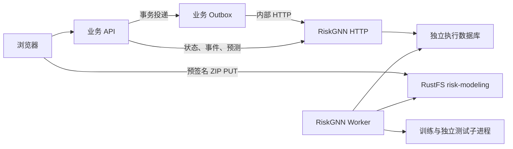

# 模型工作台

`/modeling` 分为数据集、实验、模型版本三个入口。

## 用户链路

1. ZIP 本地预览列目录并检查契约文件存在，上传进度来自浏览器实际字节传输。
2. 完成上传只代表对象就绪；后台全量校验通过后才能创建实验。
3. ACRA 使用 smoke-v1，SMEsD/UK 使用 snapshot-node-edge-v1；可设 1–20 轮，默认 2；展示阶段、曲线、Attempt 和诊断日志。
4. 可取消或在终态重新运行；URL 保存选中记录，刷新后继续轮询。
5. 独立测试成功才允许发布；模型版本可下载并预测最多 32 个图内企业。

原演示企业、报告、评分、文件链路保持独立；新加坡静态概览不显示本工作台的训练结果。
旧 /benchmark 链接进入停用说明；旧 Bundle 提交接口不再存在。

## API 与生成类型

业务前缀 `/api/v1/modeling/`，均为 POST：

| 资源 | 操作 |
| --- | --- |
| 数据集 | create-upload、complete-upload、get-dataset、list-datasets |
| 实验 | create-run、get-run、list-runs、cancel-run、rerun、run-events |
| 模型 | publish-model、get-model、list-models、download-model、predict-model |

业务契约来自 `contracts/openapi.json`；内部模型服务契约为 `contracts/riskgnn-openapi.json`。
后端 ModelClient 只依赖 HTTP 契约；前端从业务 OpenAPI 生成 DTO。
公共分页、四字段信封、Origin、Session 和请求 ID 约定继续有效。
模型服务不可用返回 503；资源跨用户访问返回 404；错误状态转换返回 409。

更多：[执行与恢复](modeling-execution.md)、[训练协议](training-profile.md)、[模型包](model-artifacts.md)。

## 统一模型服务与分析

代码位于 `models/service/`，与 baseline / riskgnn / riskgnn+ 并列。
HTTP 与 Worker 保持同一镜像；业务后端只负责归属、实验与可靠投递。
模型能力目录通过 POST `/api/v1/modeling/capabilities` 提供，已验收的模型配置才可提交。
当前仅部署 `riskgnn`，页面不提供多个模型选择；数据准备策略由适配器负责。
当前支持 ACRA、SMEsD V5 JSON、UK v1；旧 Bundle 上传协议和合成生成器已移除。
已停用的旧 Bundle 训练记录与对象保留，不把旧 worker 或旧模型网络复制成第二套实现。
数据集详情包含类型化分析报告；实验详情包含可追溯档案，均随 OpenAPI 生成前端类型。
旧协议记录本轮全部失效，不伪造分析或训练结果。

## Python 包与 HTTP 分层

服务项目仍位于 `models/service/`，源码包为 `src/model_service/`，由 uv 安装。
`app.py` 只负责应用生命周期、Dishka、中间件、错误处理与路由装配。
`dependencies.py` 管理基础设施 Provider；公共配置、数据库和 HTTP 处理位于 `shared/`。

- `modules/jobs/`：submit/get/cancel/events，拥有任务 DTO、ORM 和 Repository。
- `modules/artifacts/`：产物查询路由与 Handler；现有接口复用 jobs 快照 DTO。
- `modules/models/`：predict/capabilities/runtime，各自 DTO、Handler 及运行时服务。
- `api/route.py` 声明路径和响应；`handler.py` 做 HTTP/DTO 转换；持久化与计算不导入 HTTP DTO。

RiskGNN 模型侧 CLI 直接接入工作台；数据适配器由模型调用，原研究入口保持兼容。
通用框架只执行声明的操作、管理状态与产物；训练数据语义由适配器负责。
见[执行契约](model-execution-contract.md)及[开发与 CLI](dataset-adapters.md)。

新 ZIP 必须含 [risk_dataset_contract.json](dataset-contract.md)。本轮旧工作台记录及模型全部失效，按新协议重新上传；研究数据和静态概览保留。
