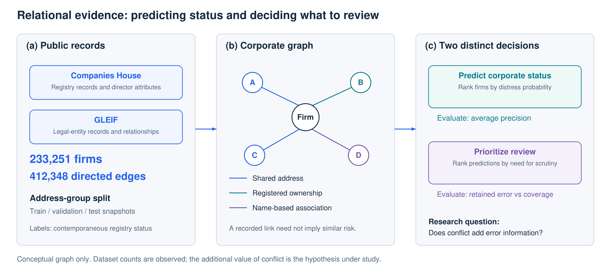
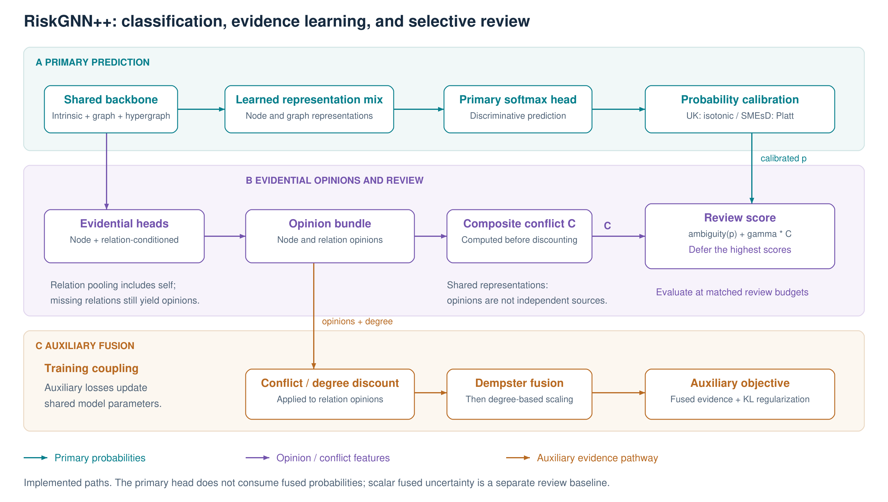
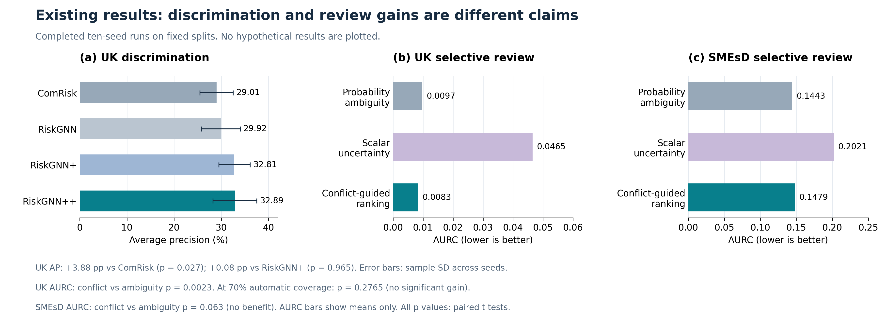

# When to Trust Relational Evidence: Conflict-Aware Corporate Distress Assessment

**Anonymous Authors — Hypothetical research draft, 13 October 2026**

> **假设性论证稿，非实证终稿。** 本版本按“补充实验支持预期机制”的情景撰写。标有 **[HYPOTHETICAL]** 的论断尚未被现有实验确立；**[PENDING VERIFICATION]** 表示需要实际证据才能替换的结果。未新增实验，未虚构数值。既有结果与负面发现保留在第 5.1 节；事实依据以[当前实证稿](riskgnn_plus_plus_paper.md)为准。

## Abstract

Corporate graphs encode relationships that differ in their relevance to financial distress. A shared address or a name-based association may be informative, but it does not establish that connected firms have similar risk states. This raises a central question: when should a model trust relational evidence, and when should its prediction be referred for review? We introduce RiskGNN++, which represents node and relation-conditioned information as evidential opinions, discounts conflicting relational evidence, and constrains fused evidence using node degree. A separate review score combines opinion conflict with calibrated probability ambiguity. We also construct a UK corporate-status graph containing 233,251 firms and 412,348 directed edges from Companies House and GLEIF records. **[HYPOTHETICAL]** Conditional analyses show that conflict retains error-detection value after accounting for predicted probability and degree. Component ablations support the roles of evidence discounting and degree scaling, while calibration and tie-handling analyses support stable review gains. Across the evaluated datasets and review budgets, the method reduces automatically retained errors by **[PENDING VERIFICATION: matched-budget estimates and uncertainty]**. These findings would establish relational conflict as a useful signal for selective corporate assessment beyond the final probability alone.

## 1. Introduction

Corporate distress assessment increasingly draws on relationships between firms. Yet the existence of a relationship and its relevance to a prediction are different questions. Shared addresses, registered ownership, and name associations encode different forms of connection. Their predictive value can vary across firms, and a recorded link alone cannot justify transferring a neighbor's risk state to the target company.

A graph classifier combines intrinsic and neighborhood information into a final prediction. That prediction is useful for ranking firms by risk, but it does not explicitly describe how the underlying opinions support competing classes. Two firms can receive similar distress probabilities even when their evidence configurations differ. This motivates examining whether the compatibility of node and relation-conditioned evidence provides information about prediction errors that the final probability does not capture.

The practical consequence concerns selective review. A limited review budget should prioritize predictions likely to be wrong, which need not be the firms with the highest distress probabilities. Probability ambiguity provides a natural baseline for this decision. Our central hypothesis is that evidential conflict can improve this baseline by preserving information about competing class support within the model. We distinguish this hypothesis from a claim that conflict directly measures financial contagion or the correctness of a registry relation.

We develop RiskGNN++ around two complementary uses of evidence. During learning, conflict- and degree-dependent discounting regulates the contribution of relational opinions to an auxiliary fused objective. For review, the model exposes a composite conflict signal and combines it with calibrated probability ambiguity. This separation allows us to evaluate evidence modeling and review ranking independently: an improvement in one does not automatically imply an improvement in the other.

To study this question in a documented corporate setting, we construct a UK graph from Companies House and GLEIF records. The dataset includes source-derived relation weights, address-group splits, and explicit contemporaneous status labels. SMEsD provides a second setting with different relation types and label prevalence. The evaluation asks whether conflict adds error information, whether the proposed components contribute to the model, and whether any review benefit survives changes in calibration, review budget, and data partition.

Our contributions are as follows. The empirical claims marked below describe the assumed successful outcome of supplementary evaluation, not completed findings.

1. **Error information beyond the final prediction. [HYPOTHETICAL]** We establish that the model's composite conflict signal retains error-detection value after conditioning on predicted probability and degree. Comparisons with simpler opinion-difference scores clarify whether the chosen evidential statistic contributes beyond generic branch disagreement.
2. **Conflict-aware evidence modeling for selective assessment.** We introduce a corporate graph model that couples relation-conditioned evidential heads with conflict discounting, degree-scaled fusion, and a separate review score. **[HYPOTHETICAL]** Retrained ablations identify the contributions of the fusion components, and matched-budget evaluation shows that conflict improves review allocation beyond probability ambiguity.
3. **A UK corporate-status graph and a structured evaluation of reliability.** We integrate 233,251 firms and 412,348 directed edges from public records with documented relation semantics and split rules. **[HYPOTHETICAL]** Supplementary evaluation demonstrates that the review benefit persists across the tested calibration procedures and data partitions, with its dataset-specific scope reported explicitly.

Figure 1 summarizes the distinction between predicting corporate status and prioritizing predictions for review.

**Figure 1. Research setting and motivation.** Public records define the UK corporate graph. Edges in the middle panel are schematic, not sampled observations; name-based associations summarize the two name relation types. Whether conflict adds error information beyond probability remains the hypothesis of this draft.

## 2. Related Work

**Corporate graph prediction.** ComRisk combines information about a firm's own condition with relational information for enterprise bankruptcy prediction [7]. It is the principal external comparison in our experiments. Our study emphasizes the additional decision of which predictions to review and develops a UK registry-based evaluation setting. RiskGNN and RiskGNN+ belong to our own research line and are included as within-family comparators; they are not independent external baselines.

**Evidential fusion and graph uncertainty.** Evidential deep learning parameterizes class evidence through a Dirichlet distribution [1], and Trusted Multi-View Classification uses evidential opinions for multi-view fusion [2]. Conflict-aware multi-view learning and trust-based discounting have also been studied [8, 9]. Graph uncertainty research includes linear opinion pooling over neighboring nodes [10]. Accordingly, Dirichlet opinions, Dempster fusion, and trust discounting are established ingredients. Our method integrates these ingredients with relation-conditioned corporate representations and an explicit review score. The distinguishing empirical question is whether the resulting conflict signal contributes error information beyond the final probability; this is the hypothetical claim evaluated in Section 5.2. We assess uncertainty scores empirically because an evidential parameterization alone does not establish faithful epistemic uncertainty [3, 4].

**Selective prediction.** Selective classification evaluates errors among predictions retained for automatic processing; SelectiveNet is one example of learning prediction and rejection jointly [11]. We instead evaluate post-hoc review scores on fixed classifier predictions. Conformal prediction addresses a different output, a set of candidate labels under a coverage criterion [5, 6]. A secondary prediction-set replay is reported in the appendix, separately from our principal risk–coverage evaluation.

## 3. Dataset and Task

### 3.1 UK corporate-status graph

The UK dataset was assembled from Companies House registry records and GLEIF legal-entity relationships, with limited API supplementation for director-derived attributes. It has 233,251 firms and four relations (`SAME_ADDRESS`, `EQUITY`, `PREVNAME`, `SAME_NAME`). Its three isolated snapshots contain 412,348 directed edges in total; the 248,517/84,060/79,771 counts refer to train/validation/test snapshots, respectively. Train/validation/calibration/test sizes are 139,956/23,332/23,332/46,631; calibration is carved out of the original validation snapshot. Splitting follows address groups, and test positive prevalence is 3.42%. The positive label is a contemporaneous registry distress status, not future loan default. Same-address edge weights encode source-derived evidence strength rather than verified edge probabilities.

### 3.2 SMEsD comparison dataset

SMEsD has 3,976 firm nodes, 2,405 person nodes, and 12 relation types. Its train/validation/calibration/test sizes are 2,816/361/360/491, with 3,556 test-snapshot edges and 64.77% test positive prevalence. The published split contains overlapping firm IDs; the experiment preserves that split. This limits independence and leakage interpretations (see the supplement).

### 3.3 Prediction and selective review

Let the corporate graph be $\mathcal{G}=(\mathcal{V},\mathcal{E},\mathcal{R})$, with binary corporate-status label $y_i\in\{0,1\}$. The positive label follows each dataset's encoding; calling it a future loan default requires a documented prediction horizon and outcome definition. The primary classifier produces $\hat p_i$, and a separate review score ranks predictions for deferral.

We use “weak relational evidence” to describe the uncertain predictive relevance of a recorded connection, rather than an established error in the underlying registry record. Source-derived weights express evidence strength, not calibrated edge probabilities. Likewise, the UK sampling and labeling process defines corporate-status assessment in the assembled population; it does not establish prospective lending performance or represent every UK firm. The construction uses legal-entity anchors and same-address neighborhoods, with director-derived attributes and hyperedges supplementing pairwise relations. Acquisition and audit details are documented in the [experiment supplement](riskgnn-plus-plus-experiments.md).

## 4. RiskGNN++: Evidence Modeling and Selective Review

This section describes the implemented model and existing calibration protocol. Supplementary protocols in Section 5 are hypothetical and have not replaced this implementation.

Figure 2 separates the implemented prediction, opinion-scoring, and auxiliary-fusion paths.

**Figure 2. Implemented RiskGNN++ pathways.** The primary classifier supplies the probabilities used for review; the conflict feature is computed before discounting. Relational opinions are discounted before fusion with the node opinion. The figure abstracts degree extraction and the auxiliary node and aggregate-graph losses. It does not imply a direct inference path from fused evidence into the primary head or an established benefit from each component.

### 4.1 Backbone and evidential branches

RiskGNN++ builds on our earlier RiskGNN+ model, retaining the intrinsic feature branch, five heterogeneous graph layers, enabled hypergraph processing, and a learnable mixture feeding the primary classifier. Community priors use training labels; training features use leave-one-out priors. The intrinsic branch is implemented by the inherited feature extractor, rather than a standalone MLP over raw attributes alone.

A node evidence head and an aggregate graph evidence head are retained for auxiliary supervision. The new relation heads pool final graph representations, including person representations where present. For each relation, the implementation averages incoming neighbor representations **together with the target's own representation**, dividing by relation in-degree plus one. An absent relation therefore still produces a self-based opinion, rather than an exactly vacuous source. An exponential of a linear projection clamped to $[-10,10]$ yields the relation evidence.

In binary subjective logic, $\alpha_k=e_k+1$, $S=\alpha_0+\alpha_1$, $b_k=e_k/S$, and $u=2/S$. Increasing total evidence therefore reduces $u$ algebraically; this identity alone does not establish whether the accumulated evidence is warranted. The heads are relation-specific, but their inputs share a graph backbone and include self-information. They should not be described as statistically independent evidence sources; dependence and repeated evidence are limitations of the fusion interpretation.

### 4.2 Discounting, fusion, and reported conflict

We reduce the contribution of a relation opinion when it conflicts with the node opinion and attenuate relational evidence as incoming degree increases. This is a modeling choice intended to temper accumulation from shared graph representations.

For opinions $\omega_a=(\mathbf b_a,u_a)$ and $\omega_b=(\mathbf b_b,u_b)$, binary conflict is $K(\omega_a,\omega_b)=b_{a,0}b_{b,1}+b_{a,1}b_{b,0}$. Relation $r$ is discounted using:

$$W_{i,r}=(1-K(\omega_i^{\mathrm{node}},\omega_{i,r}))^{\gamma_d}(1+d_i)^{-\eta}.$$

Here $d_i$ counts incoming edges of the considered relations, $\gamma_d=1$, and $\eta=0.25$. Discounting multiplies belief masses by $W_{i,r}$ and transfers the removed mass to uncertainty. The node opinion and discounted relation opinions are fused sequentially using Dempster's rule:

$$\mathbf b^{\mathrm{fused}}=\frac{\mathbf b_a\odot\mathbf b_b+\mathbf b_a u_b+\mathbf b_b u_a}{1-K(\omega_a,\omega_b)},\qquad u^{\mathrm{fused}}=\frac{u_a u_b}{1-K(\omega_a,\omega_b)}.$$

The reported conflict output is distinct from the sequential fusion normalizers. It is computed **before discounting** as the average of (i) mean node-to-relation pairwise conflict and (ii) mean relation-to-relation pairwise conflict. For one relation, the latter is zero. This composite output is used for RiskGNN++ triage and the existing appendix diagnostics; the original two-branch node-versus-graph conflict is a different quantity.

The conflict statistic measures cross-class belief mass. It is not a pure distance between predictions: identical opinions assigning positive belief to both classes can have nonzero conflict. We use it as a candidate review feature rather than a direct measure of observed relational inconsistency.

### 4.3 Degree-scaled evidence and optimization

A second degree-dependent scaling limits the amount of evidence retained after fusion. After fusion, the evidence budget is scaled as:

$$\boldsymbol\alpha_i^{\mathrm{reg}}=\mathbf1+\frac{\boldsymbol\alpha_i^{\mathrm{fused}}-\mathbf1}{1+\lambda_d d_i/(\bar d+1)},\qquad \lambda_d=0.5.$$

In the implementation, $\bar d$ is the current forward-call mean degree clamped below at one and detached from gradients. The scaling is used during both training and evaluation; reported fused probabilities and uncertainty are derived from regularized evidence. The primary probabilities remain the softmax output of the discriminative head.

The implemented objective adds primary class-weighted cross entropy, fused expected Dirichlet cross entropy (weight 0.5), node and aggregate-graph expected cross entropies (0.15 each), and fused Dirichlet KL regularization (0.001). The KL term uses $\tilde\alpha_k=y_k+(1-y_k)\alpha_k$. The evidential expected cross entropies are also class weighted. The aggregate graph head remains auxiliary and is not a separately fused source in the new multi-source combination.

The primary classifier does not directly consume the fused opinion at inference. Discounting and evidence scaling affect its parameters through shared training and auxiliary losses. Review ranking uses primary probabilities and the pre-discount composite conflict; the fused uncertainty is evaluated as a separate baseline. These distinct paths prevent a review-score improvement from identifying the effect of the fusion modules individually.

### 4.4 Calibrated conflict-guided review

Under the current class-weighted training protocol, raw probabilities are poorly calibrated. Every arm is recalibrated on the calibration split: isotonic regression on UK (23,332 points) and Platt scaling on SMEsD (360 points). Isotonic regression is nondecreasing but creates ties, which can change AP and review-score rankings. The calibration labels are reused to select the conflict weight; test labels are not used in either step.

Triage is then evaluated as a risk–coverage curve rather than a single thresholded error rate. Let $s_i$ be a review score, oriented so that larger values are deferred first. Deferring the highest-scoring firms leaves a fraction $c$ of firms processed automatically, and the selective risk $R(c)$ is the 0/1 error of those retained, using the recalibrated probability at threshold 0.5. We report the area under this curve, $\mathrm{AURC}=\int_0^1 R(c)\,\mathrm{d}c$ (lower is better), together with the risk at fixed coverage levels.

Three review scores are compared on identical predictions:

- **probability ambiguity** $0.5-|\hat p_1-0.5|$, the natural margin baseline;
- **scalar evidence uncertainty** $u$, the scalar uncertainty supplied by the fused evidential output;
- **conflict-guided ranking**, ambiguity plus $\gamma C$ with the composite conflict $C$ of Section 4.2. This is distinct from the TACR conformal score in Appendix A of the current empirical draft.

The conflict weight $\gamma$ is selected on the calibration split by minimising the calibration risk at 70% coverage, never on test; selected values range from 0.0 to 0.4 across seeds. The AURC and fixed-coverage metrics are computed on test predictions only and are paired across seeds. Review accuracy, monetary cost, and a prospective lending protocol are not modeled.

## 5. Evaluation: Existing Evidence and Hypothetical Supplementary Findings

### 5.1 Existing experimental record

The completed experiments use ten training seeds (7, 14, 21, 42, 77, 101, 314, 555, 888, 2026), a fixed data split, 250 epochs, learning rate 0.01, cosine annealing, gradient clipping at 0.25, and checkpoint selection by validation ROC-AUC every five epochs. Probability calibration uses isotonic regression on UK and Platt scaling on SMEsD. Calibration labels are also used to select the review-score weight. The existing record is summarized below; these results remain valid regardless of the hypothetical narrative.

| Completed comparison | Existing result | Supported interpretation |
| --- | --- | --- |
| UK raw AP: RiskGNN++ vs implemented ComRisk | 32.89% vs 29.01%; paired t p = 0.027 | Full-system AP improvement on the fixed UK split |
| UK raw AP: RiskGNN++ vs RiskGNN+ | 32.89% vs 32.81%; paired t p = 0.965 | No established additional AP gain |
| UK AURC: conflict-guided review vs ambiguity | 0.0083 vs 0.0097; paired t p = 0.0023 | Integrated review gain under the existing isotonic protocol |
| UK retained error at 70% automatic coverage | Paired t p = 0.2765 | No significant matched-budget gain |
| SMEsD AURC: conflict-guided review vs ambiguity | 0.1479 vs 0.1443; paired t p = 0.063 | No replicated review benefit |

The existing UK uncertainty-only score has AURC 0.0465. Isotonic calibration creates extensive ties, and the baseline uses saved input order to break them. Ten training seeds quantify training variability on the same partition; they do not constitute ten independent graph samples. Full tables, probability-quality results, and secondary prediction-set diagnostics remain in the [empirical manuscript](riskgnn_plus_plus_paper.md) and its [appendix](riskgnnpp-paper-appendix.md).

Figure 3 visualizes completed results from Section 5.1; supplementary hypotheses are not plotted.

**Figure 3. Existing ten-seed results on fixed splits.** (a) Raw UK average precision, with sample standard deviations across training seeds. (b–c) Mean AURC on identical RiskGNN++ predictions after UK isotonic and SMEsD Platt calibration; panels use different horizontal scales and do not display uncertainty intervals. The UK AURC benefit does not establish a significant 70% automatic-coverage benefit or transfer to SMEsD. Values are reproduced from the empirical manuscript, not hypothetical supplementary experiments.

### 5.2 Does conflict contain error information beyond probability?

**[HYPOTHETICAL — candidate result paragraph; evidence not yet available.]** Within groups matched on predicted probability and degree, higher composite conflict is associated with a higher rate of classification error. Adding conflict to a probability-and-degree error predictor improves held-out error identification by **[PENDING VERIFICATION: metric, effect size, interval, and evaluation partitions]**. The association remains under **[PENDING VERIFICATION: tested calibration procedures and conditioning specification]**. These results support the interpretation that conflict retains information about errors that is not fully summarized by the primary probability and degree.

**[HYPOTHETICAL — conditional interpretation.]** Comparisons with the absolute node–graph probability gap and alternative opinion-difference statistics yield **[PENDING VERIFICATION: comparative results]**. If the composite statistic consistently improves these baselines, the result supports its particular design; otherwise, the contribution should be framed as the utility of retaining multiple opinions, without claiming that Dempster conflict is uniquely effective. Even a positive conditional association does not identify noisy relations or financial contagion as its cause.

### 5.3 Which components contribute to the model?

**[HYPOTHETICAL — candidate result paragraph; retrained ablations not yet available.]** Removing conflict discounting degrades **[PENDING VERIFICATION: affected metric and paired estimate]**, while removing degree-based scaling changes **[PENDING VERIFICATION: evidence-strength behavior and predictive or review metric]**. The complete model outperforms the corresponding removals under **[PENDING VERIFICATION: matched training and evaluation protocol]**. These comparisons identify contributions to the complete learning system without assuming that the fused opinion directly supplies its primary predictions.

The interpretation must follow the observed metric. An improvement in review ranking alone supports review utility; an improvement in AP supports discrimination. A change in evidence magnitude alone does not establish improved calibration. Missing-relation handling requires a separate comparison because the current relation heads retain self-information even when no incoming edge of a relation exists. **[PENDING VERIFICATION: missing-relation comparison and its consequences for the conflict claim.]**

### 5.4 Does conflict improve review at a fixed budget?

**[HYPOTHETICAL — candidate result paragraph; positive matched-budget findings not yet available.]** At the prespecified automatic-coverage levels **[PENDING VERIFICATION: levels]**, conflict-guided review reduces retained classification error relative to probability ambiguity by **[PENDING VERIFICATION: absolute paired differences and uncertainty intervals]**. Retained positive-class errors and the fraction of all positive firms incorrectly processed automatically are reported alongside overall selective error. Their values, **[PENDING VERIFICATION: minority-class results]**, establish whether the gain extends beyond retaining a larger proportion of easy negatives.

The review scores must be compared on identical classifier predictions and the same retained population size, with a documented tie rule. Positive AURC and matched-budget findings would support complementary claims: AURC summarizes the ranking across coverage levels, while fixed-budget error measures performance at specific review capacities. Neither metric measures the accuracy of human reviewers or the economic value of deployment.

### 5.5 Does the result persist across evaluation choices?

**[HYPOTHETICAL — candidate result paragraph; supplementary robustness findings not yet available.]** The direction of the review improvement persists across **[PENDING VERIFICATION: calibration procedures, tie policies, and data partitions]**. Probability calibration and score selection use **[PENDING VERIFICATION: actual separation or cross-fitting protocol]**, and final evaluation is conducted on the corresponding held-out data. These findings limit the extent to which the result can be explained by one calibration transform or one ordering of tied scores.

**[HYPOTHETICAL — dataset extension, not a replacement of Section 5.1.]** Supplementary evaluation on SMEsD yields **[PENDING VERIFICATION: protocol and paired result]**. Any positive result must be reconciled with the existing AURC comparison of 0.1479 versus 0.1443. A changed protocol, model, or split must be named and both results reported. If the supplementary evaluation remains negative, cross-dataset benefit must be removed from the abstract and contributions while retaining a UK-specific conclusion.

## 6. Discussion and Limitations

**[HYPOTHETICAL synthesis.]** If the conditional, ablation, and matched-budget findings above hold, the study supports a specific conclusion: relational evidence can help identify which predictions require review even after the final probability is available. The contribution connects this error information to a concrete modeling and decision procedure. It does not require every component to improve every metric, and it does not depend on an AP gain over RiskGNN+ if the established advantage concerns review quality.

**Meaning of conflict.** The composite statistic measures cross-class belief mass and includes within-opinion ambiguity as well as differences between opinions. Shared representations and self-based opinions preclude an independent-source interpretation. Positive error-detection results would justify the statistic's predictive utility, not transform it into a pure disagreement distance or a causal explanation of financial distress.

**Meaning of reliability.** Lower retained error at a given coverage is a selective-prediction result. It does not establish calibrated epistemic uncertainty, prospective default probabilities, or graph-dependent conformal guarantees. Degree-dependent evidence scaling is a model constraint whose usefulness must be demonstrated at the level of the relevant outcomes.

**Data and generalization.** UK labels describe contemporaneous registration status in a source-selected population, and the original SMEsD split contains overlapping firm IDs. Positive supplementary results do not erase those properties. Generalization claims must match the actual populations, partitions, and calibration procedures tested. Dataset release status and permitted redistribution remain to be specified before describing the resource as publicly available.

## 7. Conclusion

We introduce a UK corporate-status graph and RiskGNN++, a model for using relation-conditioned evidence in both prediction and selective review. **[HYPOTHETICAL]** Conditional analyses establish error information beyond primary probability and degree; retrained ablations support the evidence-modeling components; and matched-budget evaluation shows that this information improves review allocation across **[PENDING VERIFICATION: supported settings]**. The resulting conclusion would be that relational evidence contributes not only to estimating corporate status, but also to determining when a prediction warrants further examination. Until the supplementary findings are available, the supported conclusion remains the narrower UK result documented in Section 5.1.

## References

1. Sensoy, M., Kaplan, L., and Kandemir, M. *Evidential Deep Learning to Quantify Classification Uncertainty*. NeurIPS, 2018. [Paper](https://arxiv.org/abs/1806.01768).
2. Han, Z., Zhang, C., Fu, H., and Zhou, J. T. *Trusted Multi-View Classification*. ICLR, 2021. [Paper](https://arxiv.org/abs/2102.02051).
3. Bengs, V., Hüllermeier, E., and Waegeman, W. *Pitfalls of Epistemic Uncertainty Quantification through Loss Minimisation*. 2022 preprint. [Paper](https://arxiv.org/abs/2203.06102).
4. Jürgens, M., et al. *Is Epistemic Uncertainty Faithfully Represented by Evidential Deep Learning Methods?* ICML, 2024. [Paper](https://arxiv.org/abs/2402.09056).
5. Angelopoulos, A. N., and Bates, S. *A Gentle Introduction to Conformal Prediction and Distribution-Free Uncertainty Quantification*. 2021, revised 2022. [Paper](https://arxiv.org/abs/2107.07511).
6. H. Zargarbashi, S., Antonelli, S., and Bojchevski, A. *Conformal Prediction Sets for Graph Neural Networks*. ICML, 2023. [Proceedings](https://proceedings.mlr.press/v202/h-zargarbashi23a.html).
7. Wei, S., et al. *Combining Intra-Risk and Contagion Risk for Enterprise Bankruptcy Prediction Using Graph Neural Networks*. Information Sciences, 2024, 120081. [DOI](https://doi.org/10.1016/j.ins.2023.120081); [author repository](https://github.com/shaopengw/ComRisk).
8. Xu, C., et al. *Reliable Conflictive Multi-View Learning*. AAAI, 2024. [Paper](https://arxiv.org/abs/2402.16897).
9. Lu, J., et al. *Navigating Conflicting Views: Harnessing Trust for Learning*. ICML, 2025. [Paper and version history](https://arxiv.org/abs/2406.00958).
10. Damke, C., and Hüllermeier, E. *Linear Opinion Pooling for Uncertainty Quantification on Graphs*. UAI, 2024. [Proceedings](https://proceedings.mlr.press/v244/damke24a.html).
11. Geifman, Y., and El-Yaniv, R. *SelectiveNet: A Deep Neural Network with an Integrated Reject Option*. ICML, 2019. [Proceedings](https://proceedings.mlr.press/v97/geifman19a.html).
